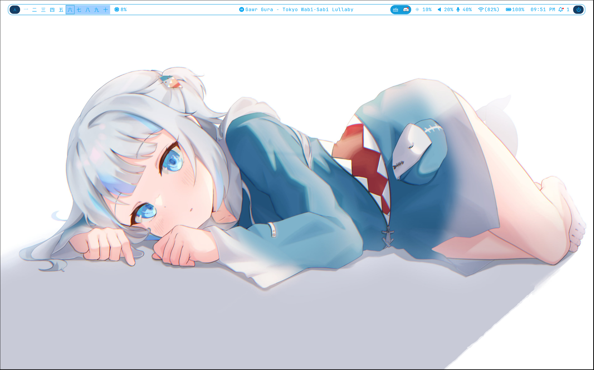
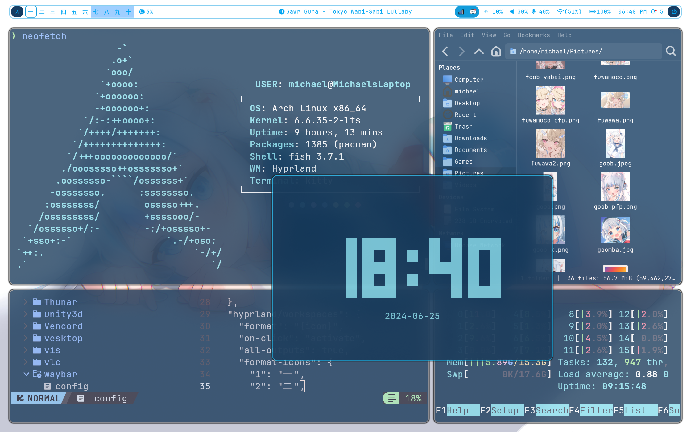
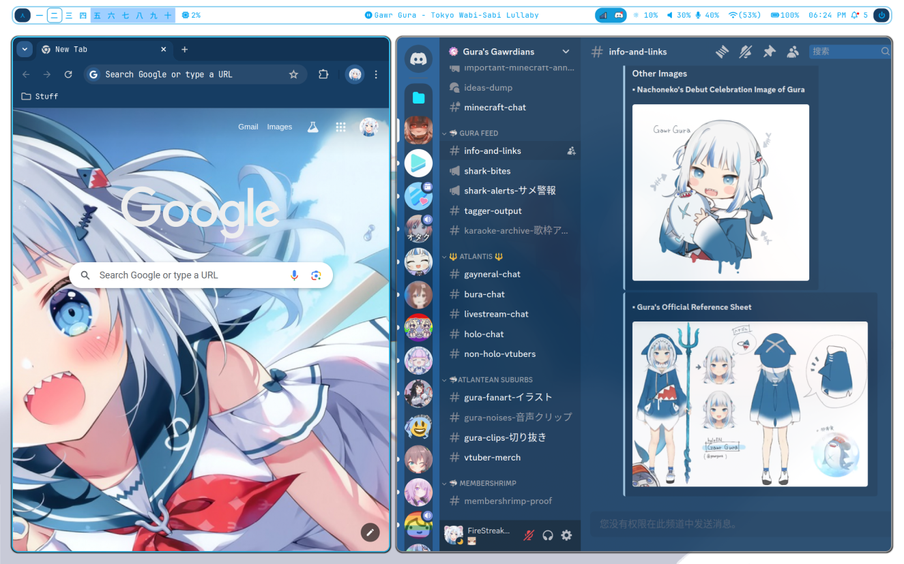
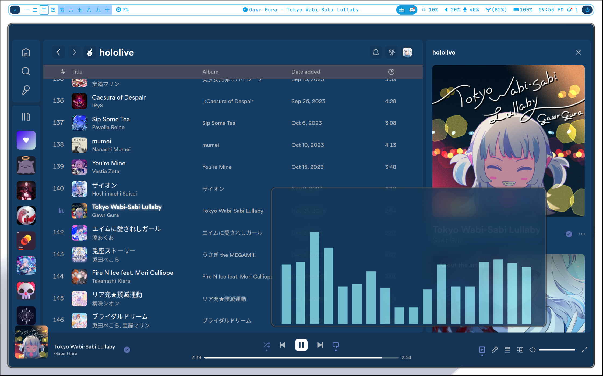
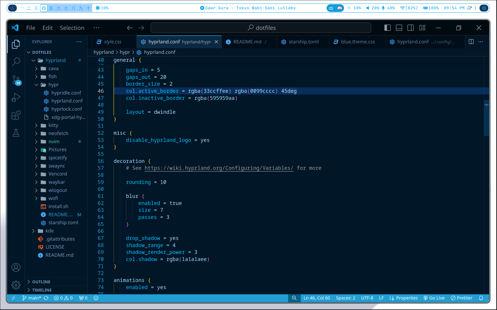
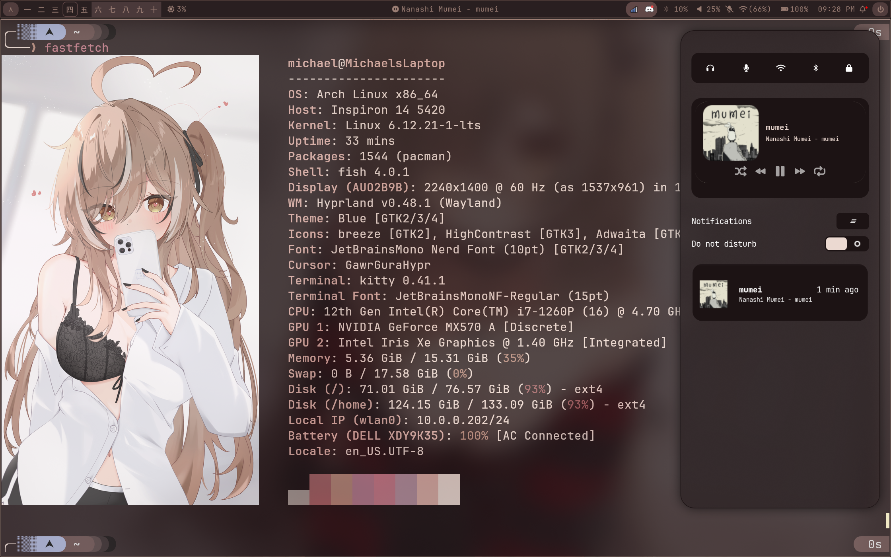
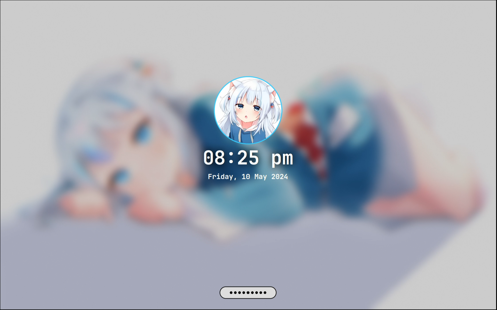
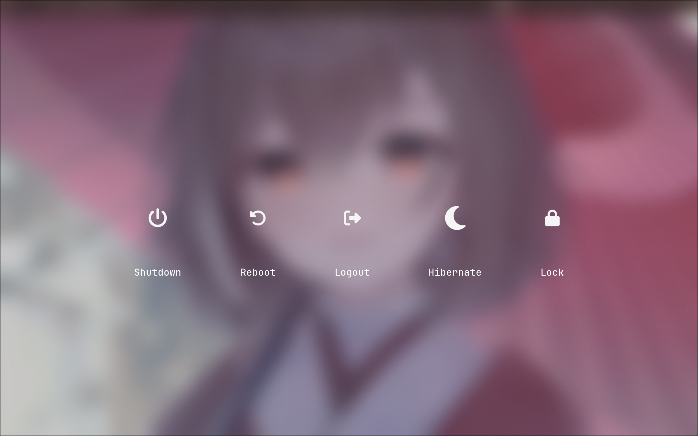

# Dotfiles

The repository containing the dotfiles for my [Hyprland](https://hypr.land/) daily driver, featuring a [Gawr Gura](https://youtube.com/@gawrgura) theme.

# Info

| Category | Application   |
| -------- | ------------- |
| Distro   | Arch          |
| WM       | Hyprland      |
| Terminal | kitty         |
| Shell    | fish          |
| Prompt   | Starship      |
| Editor   | VSCode/Neovim |
| Browser  | Google Chrome |
| Music    | Spotify       |
| Bar      | Waybar        |
| Discord  | Vencord       |

# Showcase

  
  
  
  
  
  
  
  


> A video can be found [here](https://www.youtube.com/watch?v=b3MoRgazqk4)

# Installation

```bash
$ git clone https://github.com/FireStreaker2/dotfiles
$ cd dotfiles
$ chmod +x install.sh
$ ./install.sh
```

> Note that this script is only for Arch based distributions, but feel free to modify it yourself to fit your own setup!

## Note

The screen resolution I use is 2240x1400, which means if you use a different one some things might be in the wrong position. Feel free to fork this repository and make your own edits!

# Keybinds/Shortcuts

To see all keybinds in-depth, along with their underlying logic, please refer to my [hyprland.lua](https://github.com/FireStreaker2/dotfiles/blob/main/hypr/hyprland.lua) file. For waybar shortcuts, check out my waybar [configuration](https://github.com/FireStreaker2/dotfiles/blob/main/waybar/config).

| Keybind               | Action                              |
| --------------------- | ----------------------------------- |
| `SUPER + A`           | Open terminal (`kitty`)             |
| `SUPER + S`           | Open application launcher (`wofi`)  |
| `SUPER + W`           | Open file manager (`thunar`)        |
| `SUPER + L`           | Lock screen (`hyprlock`)            |
| `SUPER + M`           | Open logout menu (`wlogout`)        |
| `SUPER + SHIFT + M`   | Exit Hyprland                       |
| `SUPER + J`           | Toggle split direction              |
| `SUPER + ESC`         | Close active window                 |
| `SUPER + SHIFT + ESC` | Force kill active window            |
| `SUPER + TAB`         | Toggle floating mode                |
| `SUPER + SHIFT + S`   | Select area and take screenshot     |
| `SUPER + F`           | Toggle fullscreen                   |
| `Print`               | Take full-screen screenshot         |
| `SUPER + ←`           | Focus window to the left            |
| `SUPER + →`           | Focus window to the right           |
| `SUPER + ↑`           | Focus window above                  |
| `SUPER + ↓`           | Focus window below                  |
| `SUPER + 1–9`         | Switch to workspace 1–9             |
| `SUPER + 0`           | Switch to workspace 10              |
| `SUPER + SHIFT + 1–9` | Move active window to workspace 1–9 |
| `SUPER + SHIFT + 0`   | Move active window to workspace 10  |
| `SUPER + Scroll Up`   | Switch to next workspace            |
| `SUPER + Scroll Down` | Switch to previous workspace        |
| `SUPER + Left Click`  | Drag active window                  |
| `SUPER + Right Click` | Resize active window                |
| `SUPER + SHIFT + ←`   | Resize window left                  |
| `SUPER + SHIFT + →`   | Resize window right                 |
| `SUPER + SHIFT + ↑`   | Resize window up                    |
| `SUPER + SHIFT + ↓`   | Resize window down                  |
| `SUPER + R`           | Switch to Dwindle layout            |
| `SUPER + SHIFT + R`   | Switch to Master layout             |
| `SUPER + '`           | Swap active window with master      |
| `Volume Up`           | Increase volume                     |
| `Volume Down`         | Decrease volume                     |
| `Mute`                | Toggle audio mute                   |
| `Play/Pause`          | Toggle media playback               |
| `Brightness Up`       | Increase brightness by 10%          |
| `Brightness Down`     | Decrease brightness by 10%          |
| `SUPER + V`           | Open clipboard history              |
| `SUPER + .`           | Open emoji picker                   |

# Credits

## Dotfiles

My dotfiles have been heavily inspired by these, and some are directly modified versions of the original

- https://github.com/prasanthrangan/hyprdots
- https://github.com/end-4/dots-hyprland
- https://github.com/zDyanTB/HyprNova
- https://github.com/SolDoesTech/hyprland
- https://github.com/7KIR7/dots
- https://github.com/Comfy-Themes/Spicetify
- https://github.com/Comfy-Themes/Discord

## Images

- [gura.png](https://twitter.com/shouu_kyun/status/1586041364457746432)
- [wallpaper1.png](https://www.pixiv.net/en/artworks/87135236)
- [wallpaper2.png](https://www.pixiv.net/en/artworks/94886012)
- [wallpaper3.png](https://danbooru.donmai.us/posts/5448225)

## Other

- [Gura SDDM](https://github.com/FireStreaker2/Gura-SDDM)
- [BlueGTK](https://github.com/FireStreaker2/BlueGTK)
- [Spotify Adblock](https://github.com/rxri/spicetify-extensions/tree/main/adblock)
- [Gawr Gura Cursor](https://ko-fi.com/s/50f0c9f48a)

# Contributing

Since these are my personal dotfiles, I won't be accepting any contributions regarding the actual configuration files. However, feel free to help edit the README or installation script!

# License

[MIT](https://github.com/FireStreaker2/dotfiles/blob/main/LICENSE)
